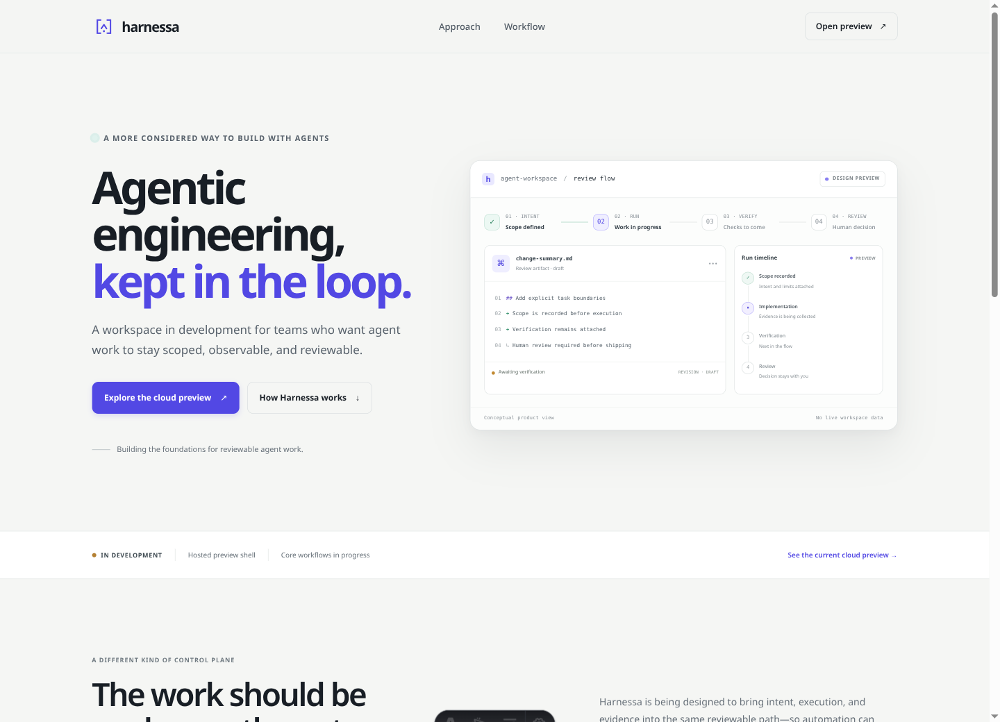
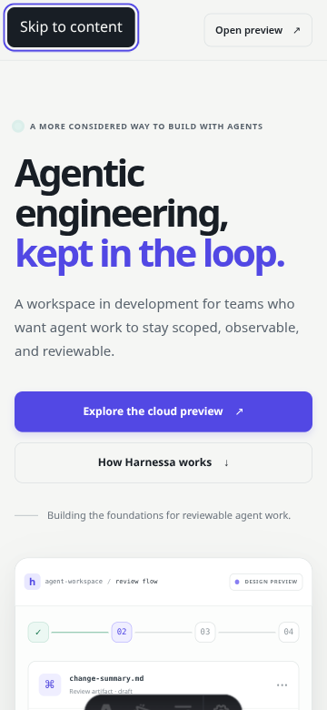
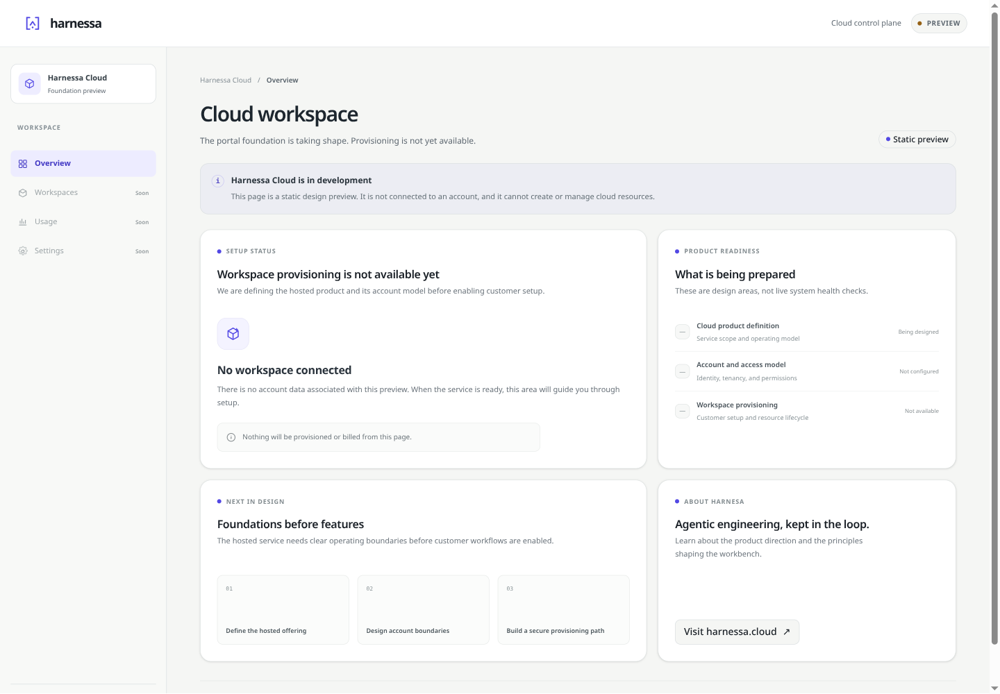
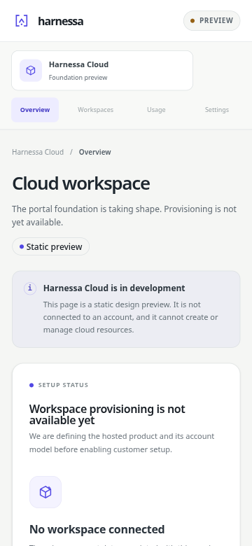

# Parallel web foundation — design system, marketing, and cloud portal

**Status:** implemented and deployed as two static Cloudflare Pages projects. Both `pages.dev` addresses and requested custom hostnames returned HTTP 200 over HTTPS on 2026-10-22. Cloudflare Pages reports both custom domains active, with verification and HTTP validation active.

## Isolation and scope

- Base SHA: `1c665dc98ac6722ee7d4947c6096c09195e48af4`.
- Work was implemented in the managed worktree `/home/menes/.codex/worktrees/design-system-cloud-sites/harnessa_v1`; the original checkout and its uncommitted files were left untouched.
- This is a standalone parallel workstream, not a numbered milestone. It did not change API, OpenAPI, database, authentication, billing, or product routes in `apps/web`.
- The existing Next.js app only gains the `@harnessa/ui-react` workspace dependency for later milestone 8 adoption.

## Delivered

- `docs/design-system.md` documents the shared product character, brand mark, semantic light/dark roles, type, shape, component contracts, and accessibility behavior.
- `packages/design-tokens` exports framework-neutral CSS tokens and Tailwind v4 semantic mappings.
- `packages/ui-react` exports typed Button, Badge, Card, Input, Alert, and class utilities in a shadcn/ui-compatible source package.
- `packages/ui-svelte` exports matching Svelte 5 components and variants for the portal.
- `apps/marketing` is a static Astro landing page that explains Harnessa's direction, marks the product as in development, and links to `app.harnessa.cloud`.
- `apps/cloud-portal` is a separate statically prerendered SvelteKit shell. It has an explicit unavailable state, no customer/account data, and no authentication, billing, API calls, or cloud-resource actions.
- A new Stitch project was used instead of the unrelated existing project. Stitch project `11838975989788558565`; design-system asset `3b8b08c364d94756a3f4b5a1412aafe0`; marketing screen `1e4d2470c6c84e6eab4515b5eaa9d43a`; portal screen `91064733bb7742a1903c6af84471a4a7`.
- `planning/prompts/parallel-design-system-cloud-sites.md` is copy-ready for isolated parallel execution. Planning index, architecture notes, milestone 8's future React-package use, and milestone 1's missing-artifact follow-up were updated. Milestones 2–4 and prompt 13 were left unchanged.

## Versions

| Area | Pinned versions |
| --- | --- |
| Workspace / runtime | pnpm 10.34.7; Node.js 24.22.1 |
| Marketing | Astro 7.4.2; Tailwind CSS and `@tailwindcss/vite` 4.3.3 |
| Portal | SvelteKit 3.1.0; Svelte 5.57.2; `@sveltejs/adapter-static` 4.0.0; Vite 8.3.5; `@sveltejs/vite-plugin-svelte` 7.3.1; TypeScript 6.0.3 |
| Svelte package | `@sveltejs/package` 3.0.1; `svelte-check` 4.7.7 |
| React package | React peer `^19.0.0`; TypeScript 5.9.3; `@radix-ui/react-slot` 1.5.0; `class-variance-authority` 0.7.1; `clsx` 2.1.1; `tailwind-merge` 3.3.1 |
| Pages CLI | Wrangler 4.151.3 |

## Build and typecheck evidence

All commands passed in this worktree:

```text
pnpm install
pnpm build:sites
pnpm typecheck:design-system
pnpm --filter @harnessa/cloud-portal check
pnpm typecheck:web
```

`pnpm build:sites` built the React package, Svelte package, static Astro output in `apps/marketing/dist`, and prerendered SvelteKit output in `apps/cloud-portal/build`. The React and Svelte packages typechecked with zero errors; SvelteKit reported zero errors and warnings; the existing web app typecheck passed. The lockfile is owned by the root workspace integration in this workstream. Generated build directories are ignored.

## Browser evidence

Browser Harness inspected local production-framework dev servers before they were stopped:

- Marketing at 1440×1040 and 360×780. The mobile document had `innerWidth = scrollWidth = body.scrollWidth = 360`. First Tab reached the visible “Skip to content” link with a solid focus outline.
- Portal at 1440×1000 and 360×780. The mobile document had `innerWidth = scrollWidth = body.scrollWidth = 360`. Tab moved through the skip link and Harnessa home link with a visible focus outline. The accessibility tree exposed navigation, headings, links, and status content.
- Reading the computed CSS variables in both apps confirmed identical light and dark values for background, foreground, primary, success, warning, and destructive roles.

Viewport captures are checked in alongside this report:









## Cloudflare deployment evidence

Account: user-selected `swarmnet` (`b4e1748b7091a5c096922e4112fc25c6`); zone: `harnessa.cloud`.

| App | Pages project | Project ID | Production deployment | `pages.dev` smoke check | Custom hostname |
| --- | --- | --- | --- | --- | --- |
| Astro marketing | `harnessa-site` | `5a1bde38-724c-43fb-b1f0-4738345f1410` | `cfbef26d-3e21-4eec-9167-a1d375f48016` — success | [HTTP 200](https://cfbef26d.harnessa-site.pages.dev) | [https://harnessa.cloud](https://harnessa.cloud) — HTTP 200, TLS verified, Pages domain active |
| SvelteKit portal | `harnessa-cloud` | `0ca3740a-381c-471a-bd1c-33f88edc74ac` | `2c65b088-d65c-46d7-89b2-7c6dd4b4ec20` — success | [HTTP 200](https://2c65b088.harnessa-cloud.pages.dev) | [https://app.harnessa.cloud](https://app.harnessa.cloud) — HTTP 200, TLS verified, Pages domain active |

DNS inspection found an existing root A record (`192.64.119.113`), five registrar email MX records, and an SPF TXT record. The root A record was replaced with a DNS-only CNAME to `harnessa-site.pages.dev`; a DNS-only CNAME to `harnessa-cloud.pages.dev` was added for `app.harnessa.cloud`. The MX and SPF records were verified unchanged after the update. Cloudflare recommends DNS-only for custom-domain errors on Pages ([debugging guidance](https://developers.cloudflare.com/pages/configuration/debugging-pages/)); the initial proxied CNAMEs returned 522 and were changed to DNS only. Both custom hostnames then served the correct site with HTTP 200 over valid HTTPS, and Pages API verification and HTTP validation are now active.

Deployment commands were equivalent to:

```text
CLOUDFLARE_ACCOUNT_ID=<swarmnet-account-id> pnpm exec wrangler pages deploy apps/marketing/dist --project-name=harnessa-site --branch=main
CLOUDFLARE_ACCOUNT_ID=<swarmnet-account-id> pnpm exec wrangler pages deploy apps/cloud-portal/build --project-name=harnessa-cloud --branch=main
```

## Remaining product and provider setup

- The cloud offering, account boundaries, identity, pricing, support path, and provisioning contracts remain undefined. The portal deliberately has no live controls until those decisions and backend boundaries exist.
- Custom domains use the supplied hostnames; no further DNS or custom-domain selection is needed.
- Wrangler reported pnpm's ignored build scripts for `esbuild` and `workerd`; this did not block builds or direct Pages uploads. No local Wrangler Workers runtime was required.
